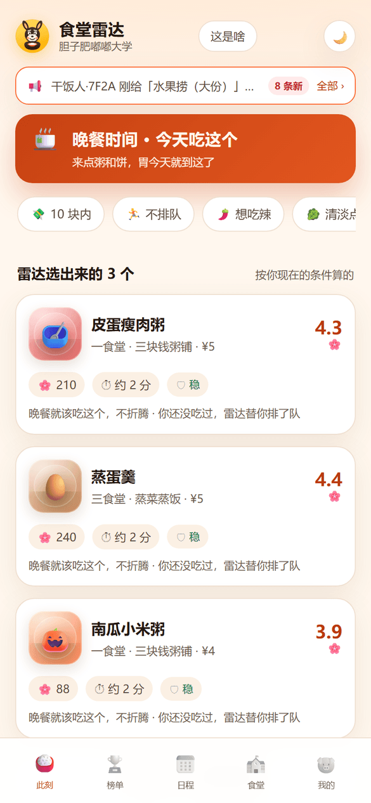
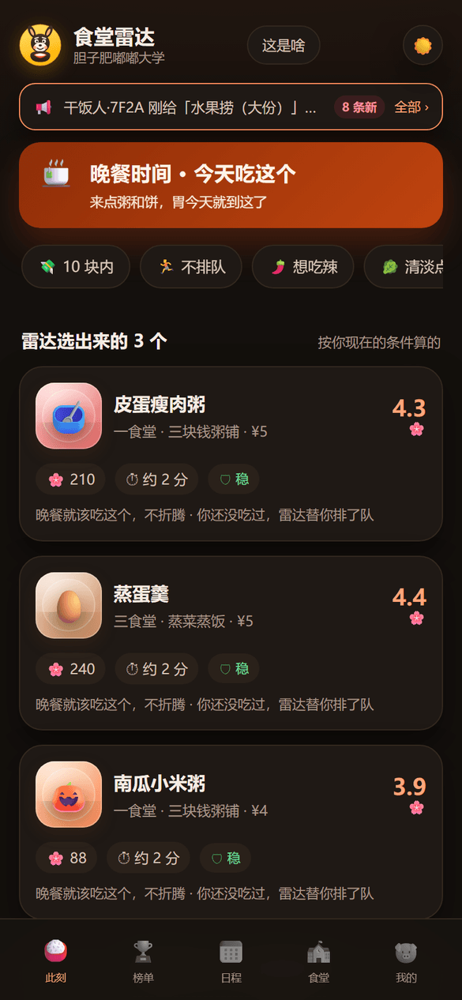
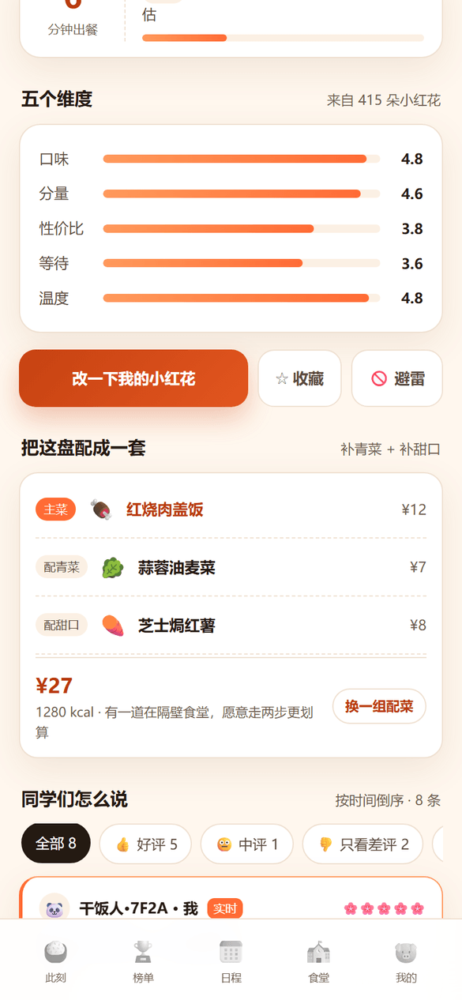
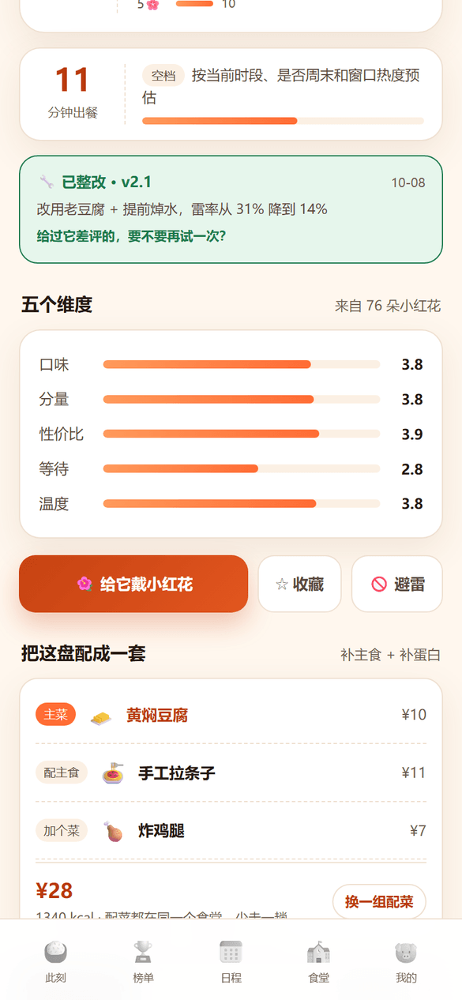
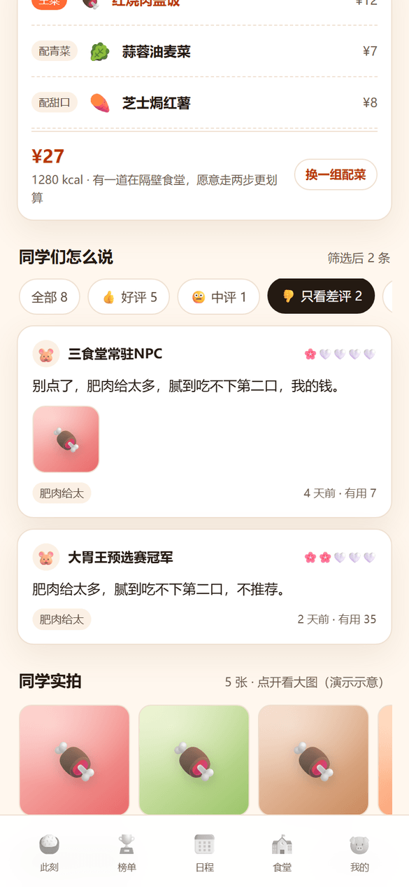
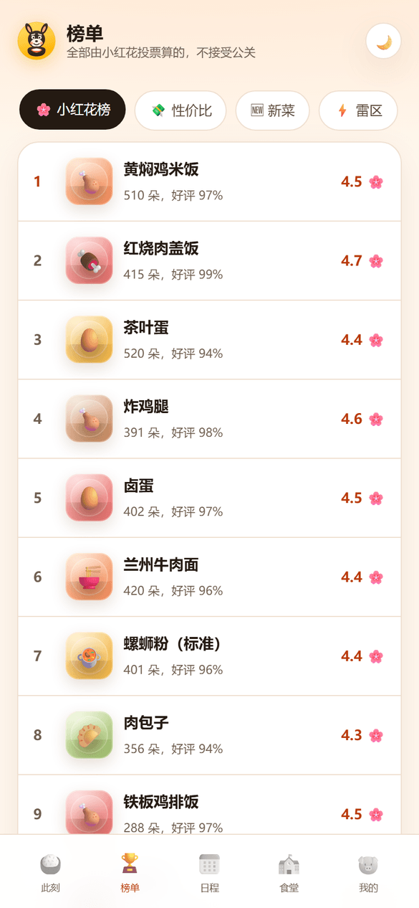
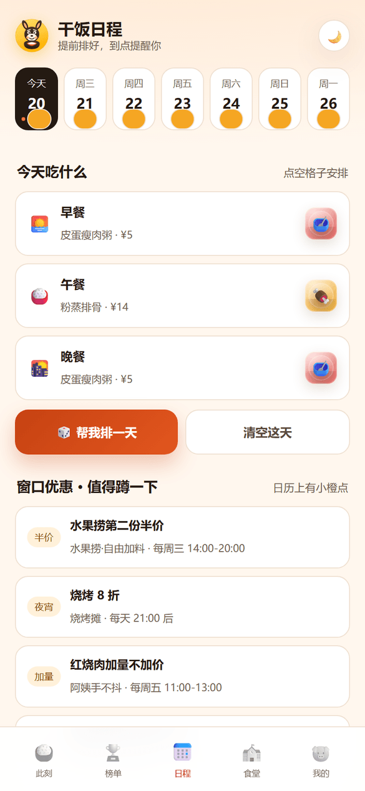
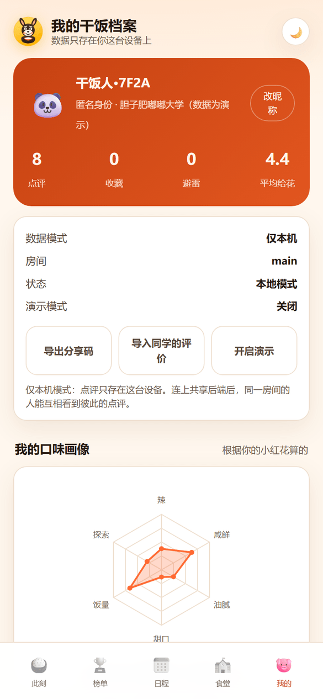
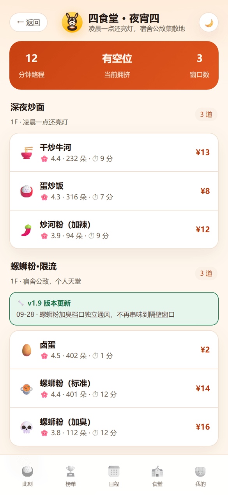
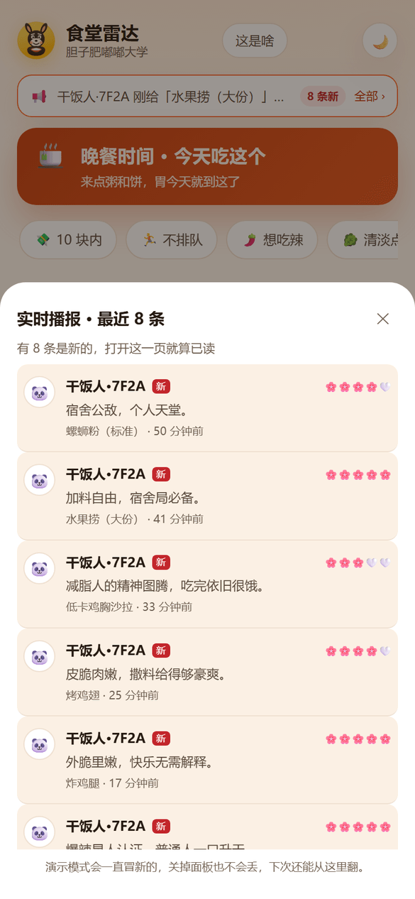

# 食堂雷达 · 胆子肥嘟嘟大学干饭指南

> 一个给大学生用的「校园食堂点评 + 决策」工具。把点评的颗粒度从「店」拆到「菜」，用小红花投票和可解释推荐回答每天最难的问题：**今天吃什么。**

**在线地址**：https://ashanqing.github.io/canteen-radar/
**最后更新**：2026-10-20 ｜ **版本**：v1.0（功能冻结）
**形态**：移动优先 Web App，纯静态、零依赖、无需登录

---

## 作品速览

| 项 | 内容 |
|---|---|
| 类型 | 产品设计 + 前端实现的个人作品（校园食堂点评推荐） |
| 一句话 | 把点评从「店」拆到「菜」，用可解释推荐回答「今天吃什么」 |
| 我的工作 | 需求拆解与调研、产品结构与信息架构、推荐/榜单/预测算法、视觉与全部前端实现、部署 |
| 交付物 | 可访问在线 demo + 完整源码与测试 + 本文档 |
| 技术 | 纯静态前端（HTML/CSS/原生 JS）、零依赖、无构建；可选 Cloudflare Worker 后端 |
| 数据 | 全部虚构：4 食堂 / 15 窗口 / 51 道菜 / 约 180 条示例评价 |
| 关键设计 | 菜品粒度、可解释推荐、Wilson 榜单、雷率（不抵消好评）、时段匹配、出餐预测、整改公告 |


---

## 一、这个产品解决什么

大众点评解决的是「一年几次的探店调研」，食堂面对的是「一周 20 次的高频决策」。所以这里不做门店评分，只做三件事：

1. **此刻该吃哪一道**——可解释推荐，给理由，不给广告
2. **哪道菜会踩雷**——雷率 + 雷区榜，差评不能被好评抵消
3. **怎么吃得更有新意**——新菜雷达、自动配菜、干饭日程

---

## 二、功能地图

| Tab | 核心功能 | 关键细节 |
|---|---|---|
| **此刻** | 顶部实时播报条、时段化推荐 3 张卡、筛选、搭配/上新托盘、踩雷预警 | 推荐卡带「为什么是它」；播报条可回溯最近 10 条并标未读 |
| **榜单** | 小红花榜 / 性价比 / 新菜 / 雷区 / 窗口榜 | 附算法说明，票少的菜不许霸榜 |
| **日程** | 一周干饭计划（早/午/晚）、帮我排一天、窗口优惠日历、到点提醒开关 | 规划日有橙点、优惠日有黄点 |
| **食堂** | 4 个食堂 → 15 个窗口 → 51 道菜，搜索 | 窗口下有「版本更新公告」 |
| **我的** | 点评、收藏、避雷清单、六维口味雷达、数据模式与分享码 | 匿名身份、可改昵称 |
| **菜品详情** | 五维评分、小红花分布、出餐预测、整改公告、评价筛选、同学实拍、自动配菜 | 评价可筛「只看差评 / 有图」 |

### 界面预览（真实渲染）

以下截图由无头 Chrome 直接渲染线上页面（390×844，2x），未做修图；数据为演示数据。

<table>
<tr>
<td width="50%"><br><sub><b>此刻 · 首页</b><br>实时播报条 + 时段化推荐 + 小红花与雷率标签</sub></td>
<td width="50%"><br><sub><b>夜间模式</b><br>同一套布局，对比度重做过，不是简单反色</sub></td>
</tr>
<tr>
<td><br><sub><b>菜品详情</b><br>小红花分布、五维评分、出餐预测、推荐理由</sub></td>
<td><br><sub><b>整改公告</b><br>出餐 11 分钟 + 版本号 + 雷率 31%→14% 前后对比</sub></td>
</tr>
<tr>
<td><br><sub><b>只看差评</b><br>按 1–2 朵花筛选，差评标签与配图聚合</sub></td>
<td><br><sub><b>榜单</b><br>小红花 / 性价比 / 新菜 / 雷区 / 窗口，附算法说明</sub></td>
</tr>
<tr>
<td><br><sub><b>干饭日程</b><br>一周计划、帮我排一天、窗口优惠、到点提醒</sub></td>
<td><br><sub><b>我的</b><br>六维口味雷达、数据模式、分享码、演示开关</sub></td>
</tr>
<tr>
<td><br><sub><b>食堂与窗口</b><br>拥挤度、窗口版本更新公告、菜品列表</sub></td>
<td><br><sub><b>播报回溯</b><br>最近 10 条点评，未读带「新」标，点开直达菜品</sub></td>
</tr>
</table>


---

## 三、核心逻辑（为什么这么设计）

### 1. 打分锚点：小红花 + 雷率

- **小红花 🌸**：一道菜一朵花一分（1–5）。1 朵 = 别点了，5 朵 = 明天还来
- **雷率 ⚡**：1–2 朵花的占比。单独成榜，**不参与好评抵消**——这是和部分平台最大的分歧
- 窗口分数由该窗口菜品聚合，食堂分数由窗口聚合

### 2. 推荐打分（可解释）

```
score = 0.16 时段匹配 + 0.19 好评率(Wilson) + 0.17 口味 + 0.13 新鲜度
      + 0.13 (1-排队) + 0.10 性价比 + 0.06 (1-距离) + 0.06 (1-雷率)
```

筛选条件会重算权重（选「10 块内」性价比升到 0.30，选「不排队」排队升到 0.32）。每条推荐理由由得分最高的两三项反查生成。

### 3. 榜单：Wilson 置信下限

```
rank = WilsonLowerBound(好评率) × log(1 + 评价数) × 时间衰减
```

只有 3 朵花的菜就算全五星，也不会排在 400 朵花的招牌菜前面。

### 4. 用餐时段匹配

早餐 5–10 / 午餐 10–15 / 晚餐 15–21 / 夜宵 21–5。每道菜按名字和标签算四个时段的适配度：

- 包子、粥、茶叶蛋 → 早餐（辣、臭、油炸在早餐扣分）
- 盖饭、炒菜、面食 → 午餐
- 粥、饼、蒸菜、清淡 → 晚餐
- 烧烤、螺蛳粉、炒面 → 夜宵

首页优先只推符合当前时段的菜，少于 6 道才放宽。所以早上不会给你推麻辣香锅。

### 5. 出餐时间预测

```
预测分钟 = 窗口基础排队 × 时段系数 × 工作日/周末 × 季节 × 出餐复杂度 × 窗口热度
```

- 时段：早/午/晚三个高峰 ×1.22，半峰 ×1.0，下午 ×0.82，夜宵 ×0.55
- 周末 ×0.78；冬季 ×1.08（热食慢）、夏季 ×0.96
- 现炒/铁板/拉面 ×1.12；包子/粥/盖饭 ×0.88
- 同时计算 10 分钟后的预测量，能省 3 分钟以上就给「错峰建议」

### 6. 自动配菜

以当前菜为主菜，按角色补位：盖饭/面类只补「青菜 + 甜口」，单炒菜补「主食 + 青菜」，沙拉补「主食 + 蛋白」。选菜时同食堂优先（少走路），并避开用粥当主食这种不合理组合。

### 7. 整改公告（商家联动）

每个窗口有版本号与更新内容，曾被差评的菜标「已整改」，并给出雷率前后对比：

> 铁板鱿鱼须 v2.2「换供应商 + 去腥 + 油温下调」，雷率 38% → 17%

落点是让踩过雷的同学愿意再试一次。

### 8. 口味雷达

六轴：辣 / 咸鲜 / 油腻 / 甜口 / 饭量 / 探索。全部由你自己点评过的菜推算，没有数据时不画空图。

### 9. 实时播报与回溯

本地演示模式每 12 秒产生一条「别的同学」的点评（最多 60 条），播报条自动轮播最近的点评；点开可看最近 10 条，未读带「新」标，读过后游标记在本地。

### 10. 分数怎么合并

页面分数 = 种子示例数据 + 真实点评（每条真实点评按 3 票计入，方便演示看到变化）。所以你会看到带「实时」标记的评论和示例评论并存。

---

## 四、数据说明

- 学校「胆子肥嘟嘟大学」、4 个食堂、15 个窗口、51 道菜、7 套搭配、5 条优惠、4 条整改公告**全部虚构**
- 示例评价由模板 + 菜品属性生成，昵称头像是固定池随机分配，**不是真实用户**
- 你的点评、收藏、日程只存在浏览器本地（localStorage）
- 演示模式产生的点评同样是模拟数据，可在「我的」里关闭

---

## 五、两种运行模式

| 模式 | 触发 | 数据在哪 | 谁能看到 |
|---|---|---|---|
| 仅本机（默认） | 直接打开 | localStorage | 只有这台设备 |
| 联网共享 | 地址加 `?api=<后端地址>&room=<房间>` | 后端 KV | 同房间所有人 |

- 后端代码在 `server/`（Cloudflare Worker + KV，约 120 行），部署步骤见 [docs/online.md](docs/online.md)
- 没有后端也能交换数据：「我的 → 导出分享码 / 导入同学的评价」
- 联网失败会自动退回本地，并进入待发送队列

---

## 六、怎么用（30 秒导览）

1. 打开首页，等 4 秒 → 顶部播报条冒出一条「别的同学」的点评
2. 点任意一道菜 → 点「👎 只看差评」，看雷率是否和差评对得上
3. 详情页往下 → 「把这盘配成一套」，点两次「换一组配菜」
4. 右上角 🌙 切夜间模式，看对比度是否还清楚
5. 「日程」→ 「🎲 帮我排一天」→ 点任意空格子手动改
6. 「我的」→ 写一条点评后，六维雷达就会长出来

---

## 七、技术架构

```
index.html            外壳 + 主题预置（防闪白）
assets/data.js        种子数据（食堂/窗口/菜品/搭配/优惠/整改）
assets/core.js        纯算法：时段、出餐、配菜、榜单、打分（无 DOM，可单测）
assets/store.js       存储层：本地 / 联网双适配器、分享码、待发送队列
assets/app.js         视图与交互：路由、渲染、事件
assets/styles.css     日/夜双主题（CSS 变量）
assets/logo.svg       校徽（手绘 SVG）
server/worker.js      共享后端（未部署）
test/*.mjs            算法测试 + jsdom 全链路冒烟
```

- 无框架、无构建、无外链资源（图片用 CSS 生成 + Emoji）
- 路由用 hash，刷新不丢状态

---

## 八、本地运行与部署

```bash
# 本地预览
python -m http.server 8080
# 打开 http://localhost:8080

# 测试
node test/check.mjs    # 数据与算法不变量
node test/meal.mjs     # 时段匹配分布
node test/wait.mjs     # 出餐预测数值
node test/smoke.mjs    # jsdom 全链路（需 npm i jsdom --prefix .tmpdom）
```

部署：推送到 `AshanQing/canteen-radar` 的 main 分支即可，Pages 自动发布。

> ⚠️ 已知坑：通过 GitHub API 直接提交的 commit **不会自动触发** Pages 构建，需要手动调一次 `POST /repos/{owner}/{repo}/pages/builds`。

---

## 九、已知限制

| 限制 | 说明 |
|---|---|
| 没有真实后端 | 共享模式需自己部署 `server/` |
| 数据是虚构的 | 见「数据说明」，不接真实食堂系统 |
| 图片是伪照片 | 菜品图用渐变生成，实拍图存在浏览器里，不能跨设备 |
| 提醒不会真弹 | demo 只记录开关状态 |
| 商家端缺席 | 整改公告是单向展示，没有食堂侧后台 |
| 无账号体系 | 匿名设备号，换设备就是新用户 |

---

## 十、后续开发计划

### P0 · 让多人真正跑起来（预计 1–2 天）

- 部署 `server/worker.js`，接 Cloudflare KV
- 评价表加字段：审核状态、可信度权重、设备指纹
- 分数从「种子 + 本地」改为「种子基线 + 全房间真实评价」
- 两个浏览器互测：A 写的点评在 B 的页面出现

### P1 · 社区与互动（预计 3–5 天）

- 「晒搭配 / 求建议」信息流：帖子、点赞、评论、举报
- 图片上传走对象存储，前端只存 URL
- 内容安全：文本与图片异步检测，审核队列
- 「我的点评 → 一键晒成帖子」

### P2 · 商家侧闭环（预计 1 周）

- 窗口管理端：回复差评、发布整改公告、上传优惠
- 整改工单：差评 → 派单 → 整改 → 回执 → 同学二次评价
- 数据看板：高频差评词、整改前后雷率对比

### P3 · 体验增强

- PWA：可安装到桌面，弱网离线可用
- 拼音首字母搜索（`hsp` → 红烧肉）
- 一键点评：只留「好吃 / 踩雷」两个大按钮
- 口味疲劳检测：连续 N 天重口后主动劝退
- 课表联动：按下一节课的时间与距离排序

### P4 · 规模化

- 多学校多租户（数据、榜单、菜系独立）
- 推荐算法从规则升级到协同过滤（有真实数据之后）
- 无障碍：读屏标签、字号缩放、对比度校验

---

## 十一、更新日志

| 日期 | 内容 |
|---|---|
| 2026-10-20 | **v1.0 功能冻结**；补充 10 张真实渲染界面截图、作品速览与路线图 |
| 2026-10-20 | 播报条可回溯最近 10 条 + 未读角标；顶部播报替换底部列表；搭配与上新合并托盘；时段匹配 |
| 2026-10-20 | 存储层抽离，支持本地/联网双模式 + 分享码；评价实时合并进分数 |
| 2026-10-20 | 首屏引导、CSS 菜品图、本地演示模式；搭配推荐、日夜双主题、校徽 |
| 2026-10-20 | 首个可访问版本：推荐、榜单、食堂、点评、小红花与雷率 |

---

## 十二、说明

这是求职作品 demo，不是上线产品。产品结构、算法逻辑和交互都可以讨论，数据不必当真。